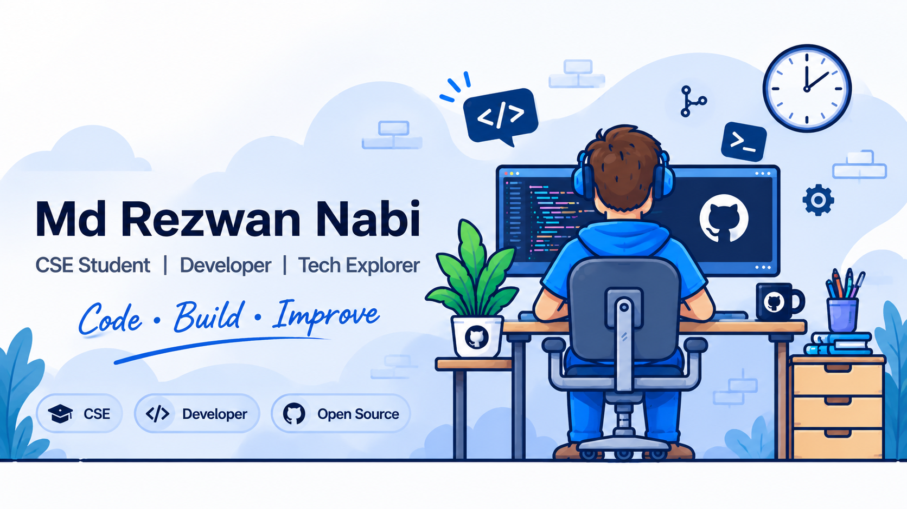

  

<h2 align="center">Hi there, I'm <a>Md Rezwan Nabi</a> 👋</h2>

  <em>Front-End focused Software Developer crafting clean, interactive, and user-friendly web experiences.</em>

  
  
  

  

### 🚀 About Me

  

- 🎓 Computer Science & Engineering student
- 💻 Interested in software development and technology
- 🚀 Building projects and learning new technologies
- 🌱 Continuously improving my development skills

  

## 🛠️ Technologies & Tools

### 📊 GitHub Metrics & Stats Dashboard

